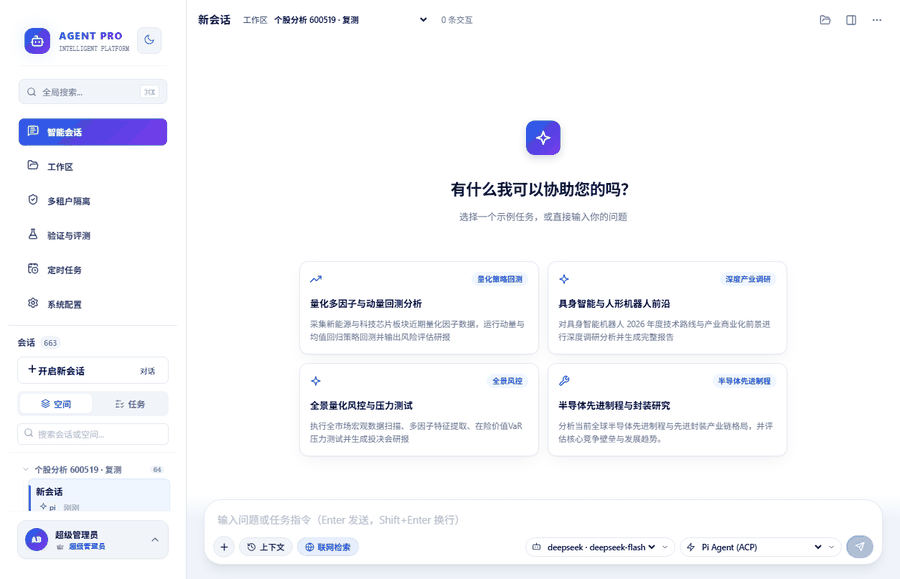
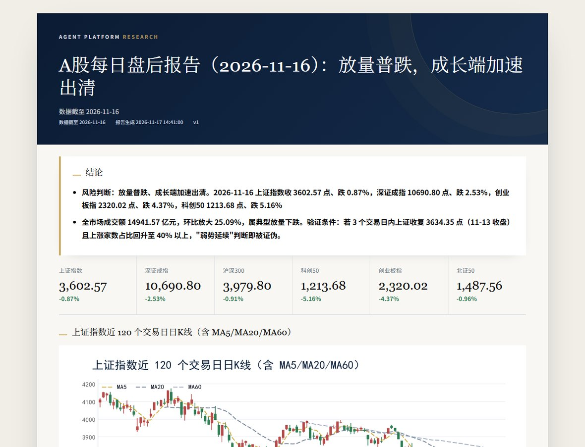
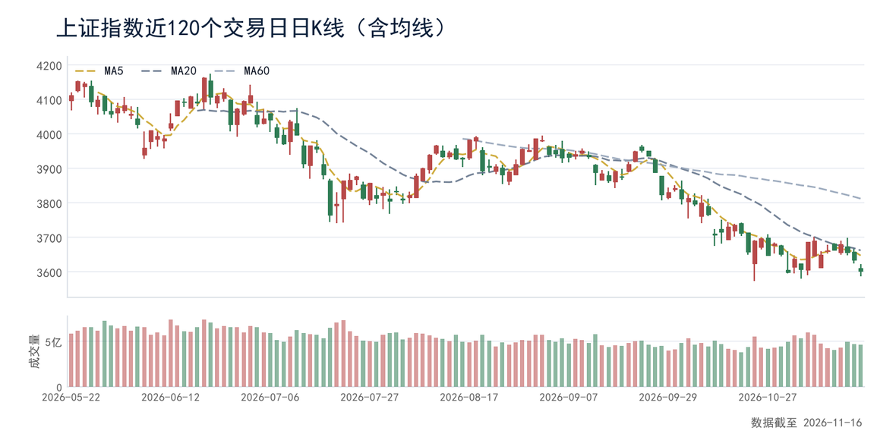
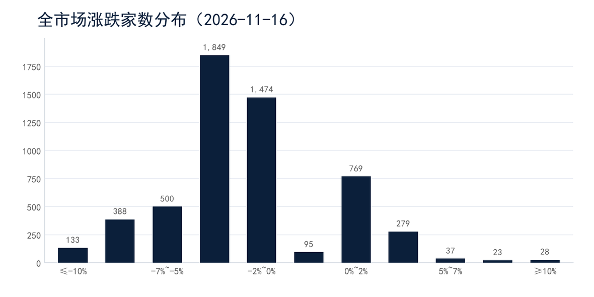
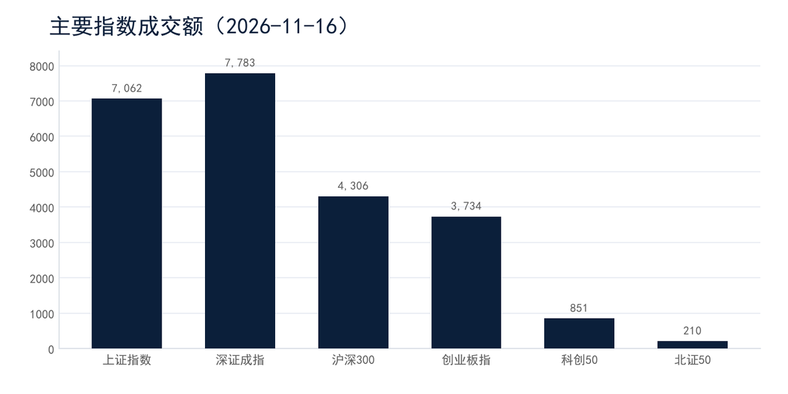

# Agent Platform

一个**确定性优先**的金融投研 Agent 平台：模型负责理解与表达，平台负责取数、授权、证据、渲染与交付。

> 本仓库是**展示仓库**：架构、效果图、样例产物、少量可运行代码切片。
> 可运行的完整实现（FastAPI + React + MCP 网关 + 数据适配器）**私有**，面试可申请只读权限。

---

## 效果



完整走一遍聊天 UAT（真实界面，非录屏拼接）：新会话 → 输入问题 → 发送 → 取数计划
（数据集 / 窗口 / 预算 / 可用工具）→ 工具执行 → 结论 + 要点表 → K 线。

| 报告页 | K 线（MA5/MA20/MA60） |
|---|---|
|  |  |

| 涨跌家数分布 | 主要指数成交额 |
|---|---|
|  |  |

一次真实会话的产物（2026-11-16，A 股盘后报告，全部来自平台实际渲染）：

- 模型只说"画什么"（`kind/subject/window`），平台取数、判型、画图；
- K 线自动叠加 MA5/MA20/MA60；窗口不够长时自动跳过该周期，不报错；
- **涨跌幅**红涨绿跌，其余数字（收盘价、股息率、换手率、最大回撤）保持黑色；
- 结论、指标表、来源与缺口都由平台渲染，四种格式（HTML/PDF/DOCX/PPTX）共用同一份 plan。

演示只做**截图 + GIF**（聊天 UAT 12 秒，713KB），不录视频。

## 能做什么

| 能力 | 说明 |
|---|---|
| 多轮投研对话 | 意图分类 → 契约 → 计划 → 工具面 → 授权 → 执行 → 交付，全程可审计 |
| 确定性取数 | `batch_fetch` 一次取全，结果落"材料"（可复用、可回溯），模型不能自己编数 |
| 证据复用 | 同一交易日/同一标的的证据可跨轮复用，不重复取数 |
| 报告交付 | 一份 `submit_report` payload → HTML / PDF / DOCX / PPTX / XLSX，同一份 plan |
| 图表 | 模型只说"画什么"，平台取数、判型、降级、渲染；画不出来写缺口，不编图 |
| 长期记忆 | 画像 + 经历 + 开放记录三层，超时降级为"仅画像"并写缺口 |
| 定时任务 | 市场日报等固定工作流，产物进同一套报告/交付链 |
| 评测与 UAT | 意图回归集、route-plan UAT、基线门禁（只拦**新增**失败） |

## 架构

```
┌────────────┐     SSE      ┌──────────────────────────────────────────────┐
│  React Web │◀────────────▶│ FastAPI  api/（鉴权、会话、聊天、导出）        │
└────────────┘              └───────────────┬──────────────────────────────┘
                                            │
                    ┌───────────────────────▼───────────────────────┐
                    │ 契约与授权层                                    │
                    │  意图 → TurnContract（kind/tools/gate/delivery）│
                    │  → 工具面（唯一 owner）→ SurfaceGrant → PDP      │
                    └───────┬───────────────────────────────┬───────┘
                            │                               │
              ┌─────────────▼─────────────┐   ┌─────────────▼─────────────┐
              │ Runtime（Pi / 工作流）      │   │ MCP 网关                   │
              │ 工具调用、prompt、交付       │   │ quant / platform-fc /     │
              │                            │   │ interaction / skills      │
              └─────────────┬─────────────┘   └─────────────┬─────────────┘
                            │                               │
              ┌─────────────▼───────────────────────────────▼─────────────┐
              │ 能力层                                                      │
              │ 取数执行 · 材料/证据 · 图表（spec→render）· 报告（payload→plan）│
              │ 记忆 · 调度 · 评测                                          │
              └─────────────┬─────────────────────────────────────────────┘
                            │
              ┌─────────────▼─────────────────────────────────────────────┐
              │ 基础设施：PostgreSQL · Redis · Qdrant · MinIO · LLM Gateway │
              └───────────────────────────────────────────────────────────┘
```

### 一次报告的完整链路（可对照账本回放）

```
用户输入
  → classify（意图帧）
  → compile_contract（kind=report，tools=[submit_report, chart_render, ...]，gate=ready）
  → build_fetch_plan（数据集/适配器/预算）
  → resolve_tool_surface（本轮到模型可见的工具）
  → runtime 执行（batch_fetch / chart_render / submit_report）
  → expand_report_charts（请求 → spec → PNG）
  → publish（HTML/PDF/DOCX + 图表 PNG + digest 命名）
  → persist（report_specs：供再导出）
  → chat_answer（结论 + 表 + 图 + 来源 + 缺口）
```

## 六条设计原则

1. **决策在 runtime，平台只提供能力**
   画不画图、写什么结论是模型的判断；平台只把它变成确定性动作。`ChartRequest` 只接受
   `kind/subject/window/...`，拒绝 `labels/values/ohlcv`——模型想直接传数据会被校验拦下。

2. **一个决策一个 owner**
   同一个事实只允许一处判断。历史上有过"图表要不要画"被模型和宿主同时判断、web 工具被两个
   MCP server 同时暴露、报告落库和导出各有一套解析——这些都已收口，并用测试钉死。

3. **身份来自内容**
   材料有稳定 id（`mat:v1:...`），图有 `chart_digest`（类型/标签/数值/OHLC/as_of/dataset +
   影响像素的展示字段）。同一张图永远同一个身份；改标题不产生新图，改窗口才会。

4. **确定性渲染**
   渲染器只消费 plan，不选数据、不算指标：HTML/PDF/DOCX/PPTX 四份产物不会"各说各话"。

5. **边界返回，不吞异常**
   画不出来 → `ok=False + reason`；报告没落库 → 显式缺口 + 日志。三次静默失败（报告从不落库、
   Word 从不带图、design 被忽略）都是这条规则反推出来的。

6. **失败必须可观测**
   `route.decided`、`tool.route`、`tool.call/result`、`chart.rendered`、`report.*`、
   `turn.terminal` —— 排查线上问题靠事实，不靠猜。

## 实测数据

前端同一条 `/api/chat` SSE 通道驱动：

| 用例 | 轮数 | 耗时 | 产物 |
|---|---:|---:|---|
| 个股报告（分析 → 公式 → 导出） | 3 | **2:05** | 2 张表（7×20、3×10）、1 张 K 线、HTML 88KB、**DOCX 46.5KB（含图）** |
| "只要文字，不要任何文件"边界 | 1 | 0:45 | **0 文件、0 图** |
| 市场简报（意图 + 新闻 + 报告） | 1 | 2:01 | 5 张表、2 张图、HTML 157KB |
| A 股盘后报告 | 1 | 1:48 | **8 张表**、4 张图、HTML 336KB |
| 从已落库 spec 再导出 PDF | — | **0.9s** | 不重新取数，同一份 spec |

其他：后端约 450 个模块；27 个已知失败（全部是数据/环境类，逐条有原因）；
导入冒烟覆盖每个模块；645 个图表/报告测试确定性通过。

## 三个工程故事

**1. 同一个 bug 出现三次：spec 被重新打包成 dict。**
报告页有图，导出的 Word 没图，publisher 只对 K 线报错。三个调用点各自 `dict(chart)`，
丢掉了 `ohlcv`，画笔抛错又被 `except` 吞成空图。修法：边界传模型对象，dict 只在外部入口转换一次。

**2. 一个决策两个 owner。**
契约声明了 `chart_render`，工具面却按 plan 重建把它丢了——模型看不见就调不到；
另一个实例是 web 工具被两个网关同时注入，模型看到两个前缀后猜错。
修法：契约是唯一来源，工具面只做过滤；每个能力一个 owner，并用测试断言。

**3. 静默失败把一个小 bug 拖成一下午。**
导出接口报"没有可导出的报告"，实际是落库路径 `except: return None`：
报告"生成成功"但 `report_specs` 零行。修法：边界返回 `ok=False + reason` 并记日志，
每个缺口都进答复。

## 代码切片

[`examples/window/`](examples/window/) 是从图表包里抽出来的一小块：把时间窗口做成**一个纯函数**
（`last_n_days` / `range` / `ytd`），并带测试钉住契约（"点太少是缺口，不是异常"）。

```bash
python -m pytest examples/window/test_window.py -q
```

其余图表实现（spec → resolve → render）在私有仓库。

## 样例产物

[`samples/`](samples/) 里是两份真实报告 HTML + 一张预览图 + 报告 payload（facts → sections），
可以直接用浏览器打开，看渲染效果，不需要跑服务。

## 状态与限制

- 个人学习项目，**不是**生产服务；
- 私有仓库正在按域收口目录（S0–S5），27 个已知失败被**记录**而不是隐藏；
- 数据适配器依赖上游行情接口，本仓库不转售或再分发任何数据；
- 样例中的日期与数字是当时的快照。

## 许可与访问

文档、样例与 `examples/` 采用 MIT（见 [LICENSE](LICENSE)）；私有实现不授权再分发。

面试需要看完整代码：可申请私有仓库只读权限（GitHub collaborator），或约一次演示讲解。
