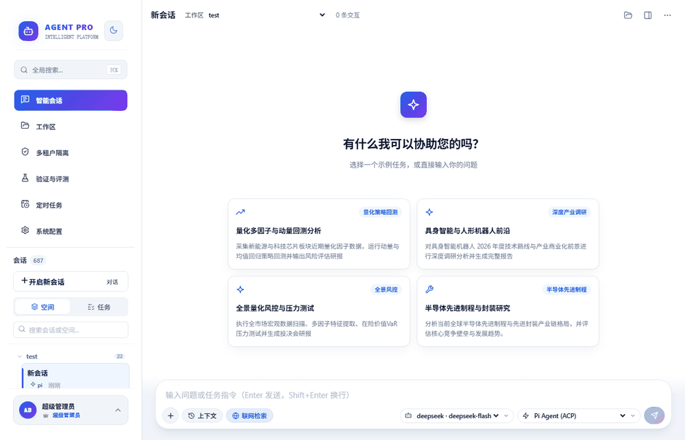
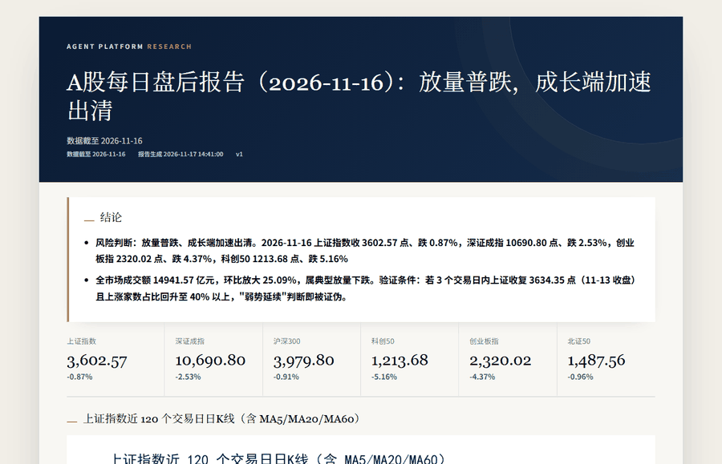
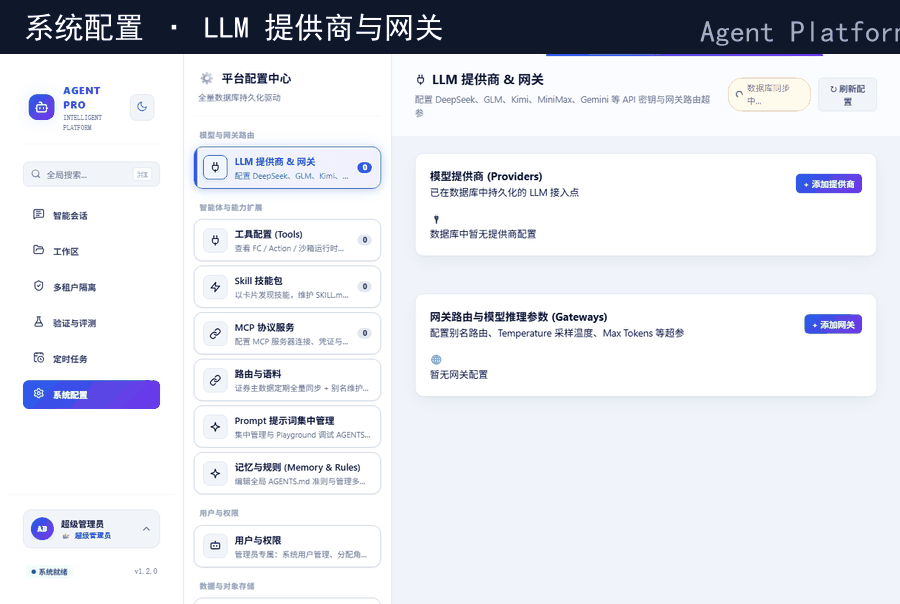
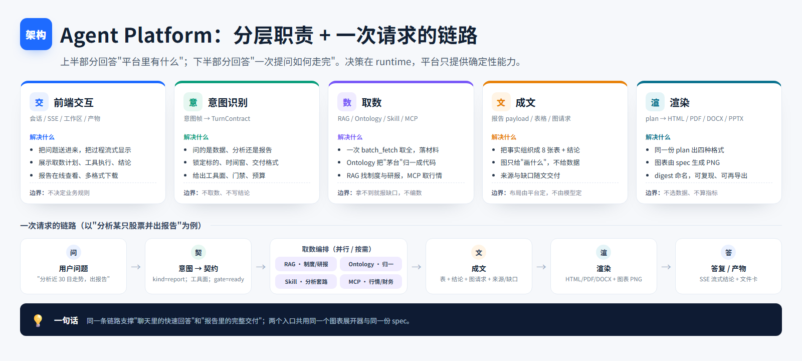

# Agent Platform

一个**确定性优先**的金融投研 Agent 平台：模型负责理解与表达，平台负责取数、授权、证据、渲染与交付。

> 本仓库是**展示仓库**：架构、效果图、样例产物、少量可运行代码切片。
> 可运行的完整实现（FastAPI + React + MCP 网关 + 数据适配器）**私有**，面试可申请只读权限。

---

## 效果

### 聊天：流式输出 + 运行记录



逐字输入 → 发送 → 取数计划（数据集/窗口/预算/工具）→ **执行轨迹与中间审计日志**
（RUN / MEMORY / CONTEXT / ROUTE / AGENT）→ 结论流式输出 → K 线 → 数据来源与缺口。

### 报告：表格 / 数据来源 / 数据缺口



整页滚动：KPI 条、K 线、分布图、成交额图、8 张表，底部"数据来源 / 数据缺口"。

### 系统页面：配置 / 工作区 / 定时任务 / 验证



LLM 提供商与网关、路由与语料、工作区、定时任务、验证与评测（13 条历史 UAT）。

三个 GIF 都是真实界面录制的（headless Edge 驱动，非拼接 mock），不录视频。

## 能做什么

| 能力 | 说明 |
|---|---|
| 多轮投研对话 | 意图分类 → 契约 → 计划 → 工具面 → 授权 → 执行 → 交付，全程可审计 |
| 确定性取数 | `batch_fetch` 一次取全，结果落"材料"（可复用、可回溯），模型不能自己编数 |
| 证据复用 | 同一交易日/同一标的的证据可跨轮复用，不重复取数 |
| 报告交付 | 一份 `submit_report` payload → HTML / PDF / DOCX / PPTX / XLSX，同一份 plan |
| 图表 | 模型只说"画什么"，平台取数、判型、降级、渲染；画不出来写缺口，不编图 |
| 长期记忆 | 画像 + 经历 + 开放记录三层，超时降级为"仅画像"并写缺口 |
| 定时任务 | 市场日报等固定工作流，产物进同一套报告/交付链 |
| 评测与 UAT | 意图回归集、route-plan UAT、基线门禁（只拦**新增**失败） |

## 架构



**上：五层职责** —— 前端交互 → 意图识别 → 取数 → 成文 → 渲染。每层只做一件事，并写明"解决什么 / 边界在哪"。

**下：一次请求的链路** —— 问题 → 契约（kind/tools/gate）→ 取数编排（RAG / Ontology / Skill / MCP 并行按需）→ 成文（表 + 结论 + 图请求 + 来源/缺口）→ 渲染（HTML/PDF/DOCX + 图表 PNG）→ 答复/产物。

两大设计约束：

- **决策在 runtime**：画不画图、写什么结论是模型的判断；平台只把它变成确定性动作；
- **一个决策一个 owner**：意图、工具面、证据选择、图表身份、报告布局，各自只有一个模块说了算。

### 一次报告的完整链路（可对照账本回放）

```
用户输入
  → classify（意图帧）
  → compile_contract（kind=report，tools=[submit_report, chart_render, ...]，gate=ready）
  → build_fetch_plan（数据集/适配器/预算）
  → resolve_tool_surface（本轮到模型可见的工具）
  → runtime 执行（batch_fetch / chart_render / submit_report）
  → expand_report_charts（请求 → spec → PNG）
  → publish（HTML/PDF/DOCX + 图表 PNG + digest 命名）
  → persist（report_specs：供再导出）
  → chat_answer（结论 + 表 + 图 + 来源 + 缺口）
```

## 六条设计原则

1. **决策在 runtime，平台只提供能力**
   画不画图、写什么结论是模型的判断；平台只把它变成确定性动作。`ChartRequest` 只接受
   `kind/subject/window/...`，拒绝 `labels/values/ohlcv`——模型想直接传数据会被校验拦下。

2. **一个决策一个 owner**
   同一个事实只允许一处判断。历史上有过"图表要不要画"被模型和宿主同时判断、web 工具被两个
   MCP server 同时暴露、报告落库和导出各有一套解析——这些都已收口，并用测试钉死。

3. **身份来自内容**
   材料有稳定 id（`mat:v1:...`），图有 `chart_digest`（类型/标签/数值/OHLC/as_of/dataset +
   影响像素的展示字段）。同一张图永远同一个身份；改标题不产生新图，改窗口才会。

4. **确定性渲染**
   渲染器只消费 plan，不选数据、不算指标：HTML/PDF/DOCX/PPTX 四份产物不会"各说各话"。

5. **边界返回，不吞异常**
   画不出来 → `ok=False + reason`；报告没落库 → 显式缺口 + 日志。三次静默失败（报告从不落库、
   Word 从不带图、design 被忽略）都是这条规则反推出来的。

6. **失败必须可观测**
   `route.decided`、`tool.route`、`tool.call/result`、`chart.rendered`、`report.*`、
   `turn.terminal` —— 排查线上问题靠事实，不靠猜。

## 技术栈

| 前端 | 后端 | 交付与验证 |
|---|---|---|
| React 18 · TypeScript 5 · Vite 5 | Python 3.12 · FastAPI · Pydantic v2 | Docker Compose（PostgreSQL / Redis / Qdrant / MinIO） |
| Zustand · React Router 6 | SQLAlchemy 2（async）· PostgreSQL · Redis · Qdrant · MinIO | GitHub Actions（基线门禁） |
| ECharts 6 · react-markdown | matplotlib · reportlab · python-docx / openpyxl / python-pptx | Vitest · Playwright（UAT） |
| Vitest · Playwright | LangChain + Agently · MCP servers（quant / platform-fc / interaction / skills）· SSE | 导入冒烟 + 645 个图表/报告测试 |

## 代码切片

[`examples/window/`](examples/window/) 是从图表包里抽出来的一小块：把时间窗口做成**一个纯函数**
（`last_n_days` / `range` / `ytd`），并带测试钉住契约（"点太少是缺口，不是异常"）。

```bash
python -m pytest examples/window/test_window.py -q
```

其余图表实现（spec → resolve → render）在私有仓库。

## 样例产物

[`samples/`](samples/) 里是两份真实报告 HTML + 一张预览图 + 报告 payload（facts → sections），
可以直接用浏览器打开，看渲染效果，不需要跑服务。

## 状态与限制

- 个人学习项目，**不是**生产服务；
- 数据适配器依赖上游行情接口，本仓库不转售或再分发任何数据；
- 样例中的日期与数字是当时的快照。

## 许可与访问

文档、样例与 `examples/` 采用 MIT（见 [LICENSE](LICENSE)）；私有实现不授权再分发。

面试需要看完整代码：可申请私有仓库只读权限（GitHub collaborator），或约一次演示讲解。
